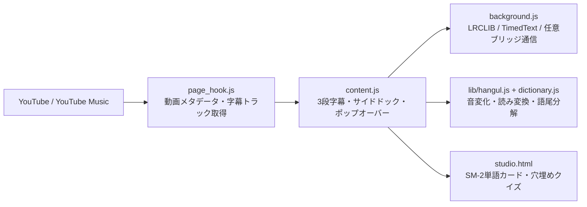

# K-Lyric Studio

YouTube・YouTube Music で K-POP の楽曲や韓国語動画を見ながら韓国語を学べる Chromium (MV3) / Firefox 対応ブラウザ拡張機能です。

## 主な特徴

- **3段オーバーレイ字幕と7大音変化ルールエンジン**
  - ハングル原文（単語クリック可能）・音変化適用済みの読み方ガイド・日本語訳の3段を動画プレイヤー上に表示します。
  - 口蓋音化（`같이 → 가치`）、ㅎ弱化（`좋아해 → 조아해`）、激音化（`어떡해 → 어떠캐`）、鼻音化（`없는 → 엄는`）、流音化（`설날 → 설랄`）、濃音化（`학교 → 학꾜`）、連音化をルール変換します。
- **カタカナ + 音節ローマ字のハイブリッド読み方**
  - 既定では `ソルレジャナ · seol-le-ja-na` のように、拍を瞬時に追えるカタカナと母音/パッチムを正確に識別できる音節ローマ字を併用します。
  - ボタン1つで `併用` / `カタカナのみ` / `ローマ字のみ` / `発音ハングル` / `オフ` の5モードを切り替えられます。
- **同期台本サイドドックと区間練習**
  - YouTube 字幕（韓国語 + 日本語/自動翻訳）および LRCLIB 同期歌詞に対応し、MV冒頭ズレ補正（`±0.5s` / 現在秒数合わせ）、1行リピート、末尾自動一時停止、速度切替（`1.0x / 0.85x / 0.75x`）、語彙カバー率バー、LRC手動貼付を備えます。
- **原形復元・語尾分解ポップオーバーと曲連動 SM-2 復習スタジオ**
  - 単語をクリックすると基本形・活用語尾/助詞・意味・3点発音表記を表示し、出典動画の該当秒数リンク付きで単語帳へ保存できます。
  - 復習スタジオでは SM-2 単語カード、歌詞穴埋めクイズ、JSON/TSV インポート・エクスポートが利用できます。
- **オプションのローカルAIブリッジ**
  - サーバーなしでも拡張機能単体で完結して動作します。必要に応じて `bridge/k_lyric_bridge.py` を起動すると、字幕なし動画の文字起こしや OpenAI 互換ローカル LLM による文脈解説を連携できます。

## アーキテクチャ



## 画面イメージ

- プレイヤー上の3段字幕・語句分解ポップオーバー・同期台本ドック: `docs/screenshot-player.png`
- 復習スタジオ（SM-2 単語カード・歌詞穴埋め・一覧管理）: `docs/screenshot-studio.png`

## 導入方法

1. Vivaldi / Chrome / Edge で `chrome://extensions` を開きます。
2. 右上の「デベロッパー モード」を有効にします。
3. 「パッケージ化されていない拡張機能を読み込む」からこのフォルダを選択します。
4. Firefox の場合は `about:debugging#/runtime/this-firefox` から `manifest.json` を読み込みます。

## ローカルテスト

```bash
node --test tests/core.test.mjs
python -m unittest discover -s tests -v
```
