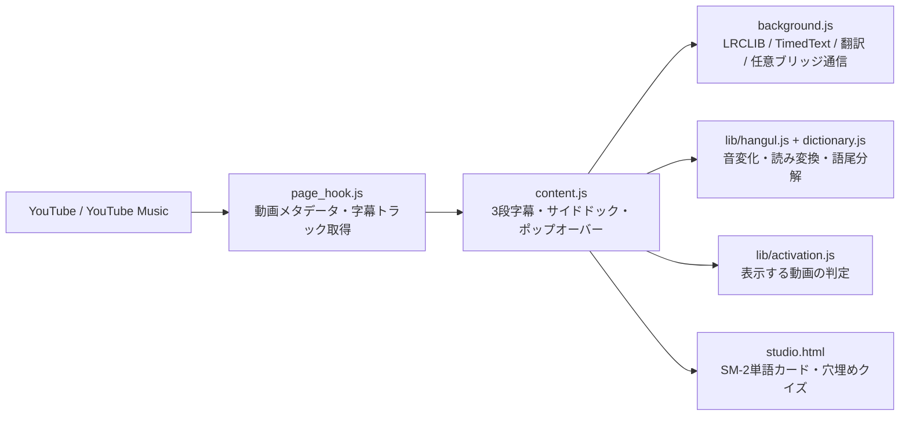

# K-Lyric Studio

YouTube・YouTube Music で K-POP の楽曲や韓国語動画を見ながら韓国語を学べる Chromium (MV3) / Firefox 対応ブラウザ拡張機能です。

## 主な特徴

- **3段オーバーレイ字幕と7大音変化ルールエンジン**
  - ハングル原文（単語クリック可能）・音変化適用済みの読み方ガイド・日本語訳の3段を動画プレイヤー上に表示します。
  - 口蓋音化（`같이 → 가치`）、ㅎ弱化（`좋아해 → 조아해`）、激音化（`어떡해 → 어떠캐`）、鼻音化（`없는 → 엄는`）、流音化（`설날 → 설랄`）、濃音化（`학교 → 학꾜`）、連音化をルール変換します。
- **カタカナ + 音節ローマ字のハイブリッド読み方**
  - 既定では、拍を瞬時に追えるカタカナと母音/パッチムを正確に識別できる音節ローマ字を併用します。
  - 読み方はハングルの1音節ごとに真下へ揃え、カタカナとローマ字は別々の行に出します（`설` の下に `ソル`、その下に `seol`）。英語など韓国語以外の語には読み方の行を付けません。
  - ボタン1つで `併用` / `カタカナのみ` / `ローマ字のみ` / `発音ハングル` / `オフ` の5モードを切り替えられます。`発音ハングル` では音変化で綴りと発音が変わる音節を色分けします。
- **YouTube Music 対応**
  - 検索・ホームからの選曲、次の曲・自動再生での曲の切り替わりを検知して、歌詞を読み込み直します。
  - 動画のない曲（ジャケット画像表示）でも、画像の上に字幕を重ねます。広告の再生中は字幕を隠します。
  - 歌詞パネルは「たたむ」で見出しだけにできます。
- **日本語訳と単語の意味**
  - YouTube の日本語字幕がない歌詞（LRCLIB の同期歌詞や手で貼った歌詞）は、韓国語の行を Google 翻訳（`translate.googleapis.com`、APIキー不要）で訳し、各行の下に表示します。機械翻訳なので誤訳があり、歌詞パネルの見出しに「訳は機械翻訳」と出します。「日本語訳」ボタンで表示・非表示を切り替えられます。
  - 動画上の字幕・歌詞パネルのどちらでも、単語をクリックすると意味を表示します。内蔵辞書にある語は辞書の意味を、ない語は基本形とその活用形の機械翻訳を出します。歌詞パネルの単語以外の部分をクリックすると、その行へ移動します。
  - 翻訳のために送るのは歌詞の行と単語だけです（再生中の動画の情報やアカウント情報は送りません）。
- **字幕の大きさ**
  - 字幕の文字の大きさは、プレーヤーの幅と高さに合わせて自動で変わります（17〜34px）。YouTube Music のジャケット表示でも小さくなりすぎず、全画面でも小さく見えません。
- **表示する動画の選び方**
  - YouTube は登録したチャンネル・動画・キーワードに当てはまる動画だけ（初期値は ILLIT のチャンネルと「ILLIT」「아일릿」を含むタイトル）、YouTube Music は「非表示」に登録したもの以外すべてで表示します。
  - 表示していない動画では右下に「この動画で表示」「このチャンネルで表示」を出し、表示中の動画では歌詞パネルの「この動画では非表示」「このチャンネルでは非表示」で切り替えられます。登録の一覧・削除・キーワード追加は設定画面で行います。
- **歌以外の韓国語動画**
  - YouTube は字幕の直接ダウンロードを制限しているため、取れないときはプレーヤー自身の韓国語字幕を一瞬だけ（画面には出さずに）読み込んで使い、元の字幕設定に戻します。
  - 曲名が付いていない動画では、長さが合わない同期歌詞を当てはめません（関係ない曲の歌詞が出るのを防ぐため）。
- **字幕の表示切替と歌詞パネル**
  - 「動画の字幕」ボタンで動画上の字幕だけを隠せます（歌詞パネルは残ります）。
  - 歌詞パネルは再生中の行を下から2番目に置き、次の行が常に見えるようにスクロールします。
  - 右側の列が他の拡張機能などで隠されているときや画面が狭いときは、右下に浮かせて画面の高さに収まるように表示します。
- **同期台本サイドドックと区間練習**
  - YouTube 字幕（韓国語 + 日本語/自動翻訳）および LRCLIB 同期歌詞に対応し、MV冒頭ズレ補正（`±0.5s` / 現在秒数合わせ）、1行リピート、末尾自動一時停止、速度切替（`1.0x / 0.85x / 0.75x`）、語彙カバー率バー、LRC手動貼付を備えます。
- **原形復元・語尾分解ポップオーバーと曲連動 SM-2 復習スタジオ**
  - 単語をクリックすると基本形・活用語尾/助詞・意味・3点発音表記を表示し、出典動画の該当秒数リンク付きで単語帳へ保存できます。
  - 復習スタジオでは SM-2 単語カード、歌詞穴埋めクイズ、JSON/TSV インポート・エクスポートが利用できます。
- **オプションのローカルAIブリッジ**
  - サーバーなしでも拡張機能単体で完結して動作します。必要に応じて `bridge/k_lyric_bridge.py` を起動すると、字幕なし動画の文字起こしや OpenAI 互換ローカル LLM による文脈解説を連携できます。

## アーキテクチャ



## 画面イメージ

- プレイヤー上の3段字幕・語句分解ポップオーバー・同期台本ドック: `docs/screenshot-player.png`
- 復習スタジオ（SM-2 単語カード・歌詞穴埋め・一覧管理）: `docs/screenshot-studio.png`

## 導入方法

1. Vivaldi / Chrome / Edge で `chrome://extensions` を開きます。
2. 右上の「デベロッパー モード」を有効にします。
3. 「パッケージ化されていない拡張機能を読み込む」からこのフォルダを選択します。
4. Firefox の場合は `about:debugging#/runtime/this-firefox` から `manifest.json` を読み込みます。

## ローカルテスト

```bash
node --test tests/core.test.mjs
python -m unittest discover -s tests -v
```
